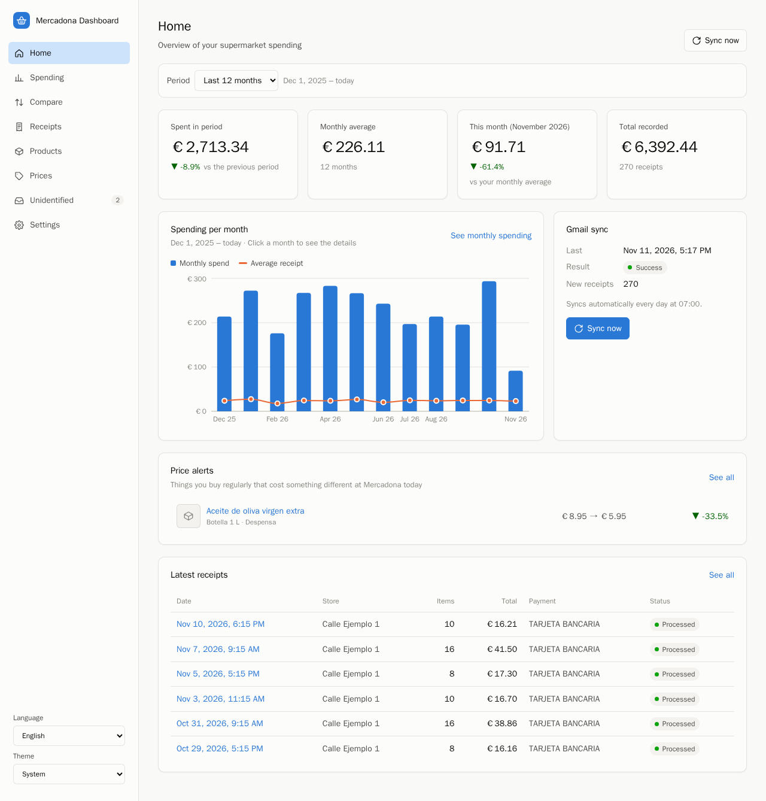
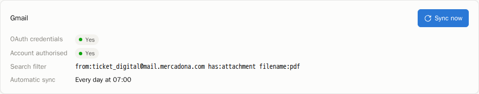
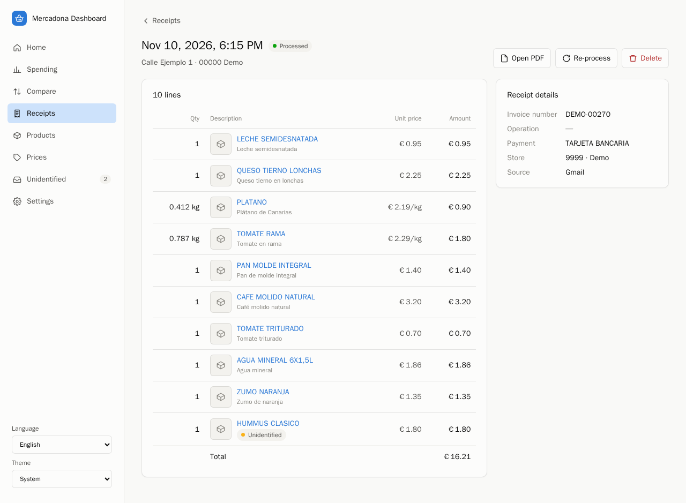
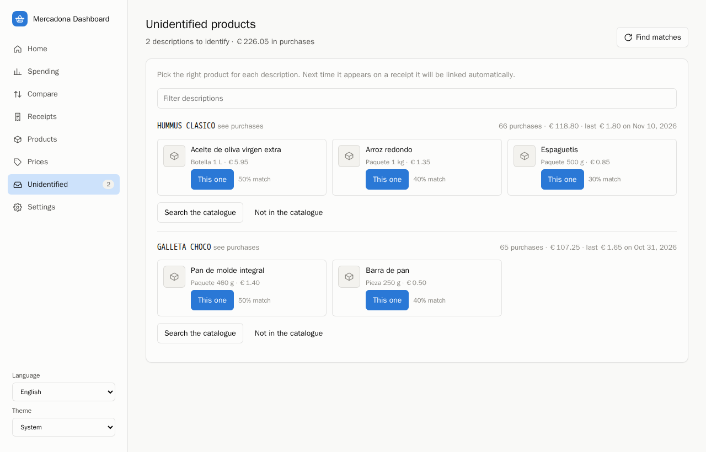
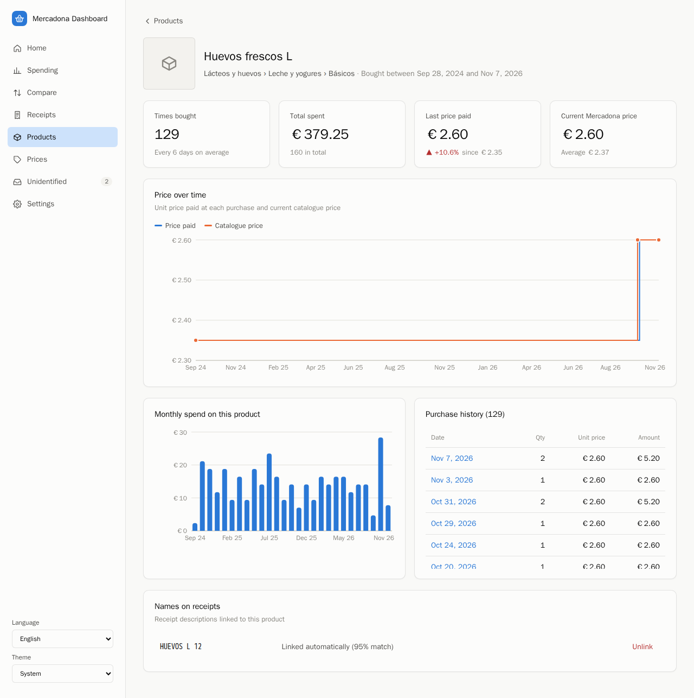
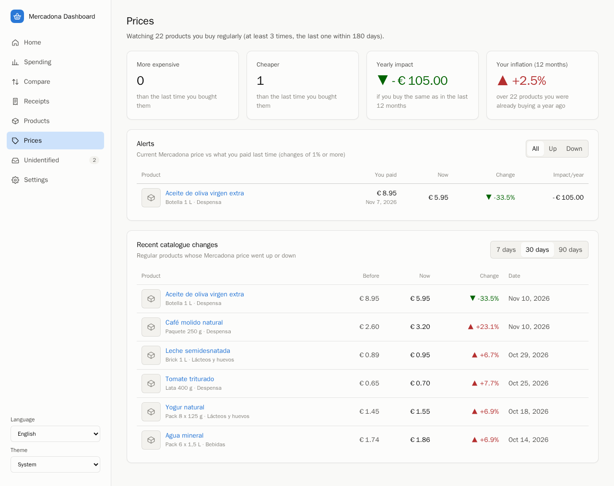
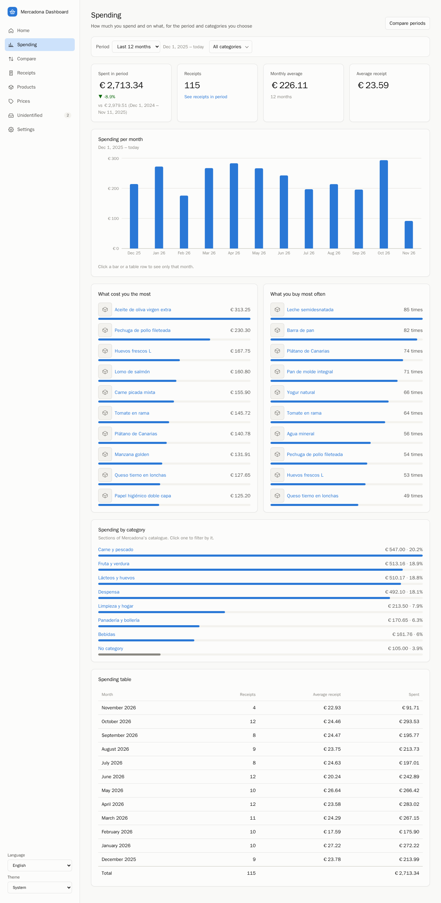
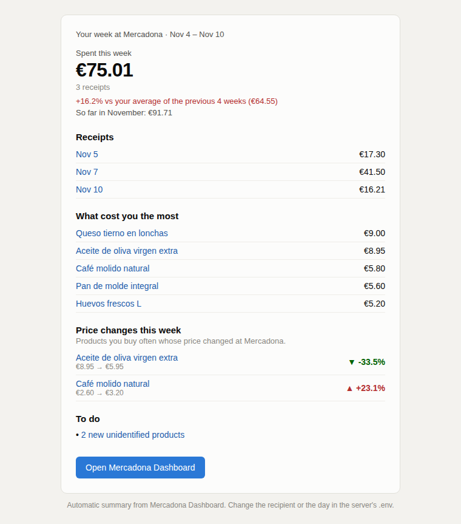
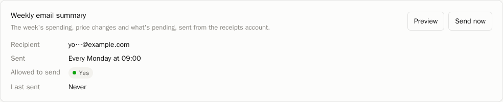

# Installation guide

This guide takes you from nothing to a running Mercadona Dashboard that imports your
digital receipts from Gmail every morning. It assumes no previous knowledge of Google
Cloud. Allow about 45 minutes, most of it in the Gmail and Google Cloud steps.



<sub>All screenshots in this guide use the fictitious demo data described in
[step 3](#3-optional-try-it-with-demo-data).</sub>

## Contents

1. [What you need](#1-what-you-need)
2. [Install and start the app](#2-install-and-start-the-app)
3. [Optional: try it with demo data](#3-optional-try-it-with-demo-data)
4. [Get your receipts into a Gmail account](#4-get-your-receipts-into-a-gmail-account)
5. [Create the Google Cloud credentials](#5-create-the-google-cloud-credentials)
6. [Authorise the app to read your receipts](#6-authorise-the-app-to-read-your-receipts)
7. [First import](#7-first-import)
8. [Identify the products you buy](#8-identify-the-products-you-buy)
9. [Optional: weekly email summary](#9-optional-weekly-email-summary)
10. [Keeping it running](#10-keeping-it-running)
11. [Troubleshooting](#11-troubleshooting)

---

## 1. What you need

| | |
|---|---|
| **A computer that stays on** | Any Linux machine, a Mac or Windows with WSL2. The app imports receipts once a day, so a small home server, a mini PC or an old laptop is ideal. 2 GB of RAM is enough. |
| **Docker** | Docker Engine with the compose plugin (Linux) or Docker Desktop (Mac/Windows). |
| **git** and **make** | Preinstalled on most Linux and Mac systems (`xcode-select --install` on a Mac). |
| **A Gmail account** | Where your Mercadona receipts arrive. A dedicated account is recommended, see [step 4](#4-get-your-receipts-into-a-gmail-account). |
| **Mercadona digital receipts** | Mercadona's *ticket digital*: instead of a paper receipt, every purchase is emailed to you as a PDF. Sign up at the checkout or on mercadona.es. |

The app has **no login** and serves plain HTTP. Run it on your home network only and do
not expose it to the Internet.

### Install Docker

**Linux (Debian, Ubuntu, Linux Mint):**

```bash
curl -fsSL https://get.docker.com | sh
sudo usermod -aG docker $USER      # use docker without sudo
sudo systemctl enable docker       # start on boot
```

Log out and back in, then check it works:

```bash
docker run --rm hello-world
```

**Mac / Windows:** install [Docker Desktop](https://www.docker.com/products/docker-desktop/)
and start it. On Windows, run every command in this guide inside a WSL2 terminal.

---

## 2. Install and start the app

### 2.1 Download the code

```bash
git clone https://github.com/B0rjitaaa/mercadona-dashboard.git
cd mercadona-dashboard
```

### 2.2 Create the configuration file

```bash
cp .env.prod.example .env
```

Open `.env` in a text editor and fill in the blanks:

| Setting | What to put |
|---|---|
| `DJANGO_SECRET_KEY` | A long random string. Generate one with `openssl rand -base64 48`. |
| `POSTGRES_PASSWORD` | Any strong password. You never type it again. |
| `DJANGO_ALLOWED_HOSTS` | Replace `<server-ip>` and `<server-hostname>` with the computer's local IP (e.g. `192.168.1.50`) and name. Find the IP with `hostname -I` (Linux) or `ipconfig getifaddr en0` (Mac). |
| `CSRF_TRUSTED_ORIGINS` | The same IP and name, as `http://<ip>:8080`. |
| `REPORT_BASE_URL` | `http://<ip>:8080`, used by the links in the weekly email. |
| `TIME_ZONE` | Leave `Europe/Madrid` unless you live in the Canary Islands (`Atlantic/Canary`). |
| `MERCADONA_POSTAL_CODE`, `MERCADONA_WAREHOUSE` | See [2.3](#23-your-mercadona-warehouse). |

Leave the Gmail and `REPORT_*` settings as they are for now.

Also add this line, so that a plain `docker compose` in this folder acts on the production
stack (handy for backup scripts):

```bash
COMPOSE_FILE=docker-compose.prod.yml
```

### 2.3 Your Mercadona warehouse

Product prices come from Mercadona's online shop, which has slightly different prices and
products per region. The app needs the code of the warehouse that serves your postal code.
The default (`41008` / `svq1`, Seville) works anywhere; set yours if you want exact local
prices:

1. Open <https://tienda.mercadona.es> in Chrome or Firefox and enter your postal code.
2. Open the developer tools (<kbd>F12</kbd>) → **Network** tab, and reload the page.
3. Click any request to `tienda.mercadona.es/api/...`. Its URL ends in `?lang=es&wh=xxx1`:
   `xxx1` is your warehouse (e.g. `mad1`, `bcn1`, `vlc1`).
4. Put your postal code in `MERCADONA_POSTAL_CODE` and that code in `MERCADONA_WAREHOUSE`.

### 2.4 Start it

```bash
make prod-up
```

The first time takes a few minutes: it builds the images, creates the database and
compiles the web app. Check that all services are `Up`:

```bash
make prod-ps
```

Open `http://<ip>:8080` in a browser (or `http://localhost:8080` on the same computer).
You will see an empty dashboard. The language selector is at the bottom left.

> **Developing instead?** `cp .env.example .env && make up` starts the development stack
> (hot reload, frontend on port 5173, no scheduled jobs). See the [README](../README.md).

---

## 3. Optional: try it with demo data

Want to look around before connecting Gmail? Fill the empty database with fictitious
receipts (two years of shopping at an imaginary store):

```bash
docker compose -f docker-compose.prod.yml exec backend python manage.py seed_demo
```

Remove them before importing your own receipts:

```bash
docker compose -f docker-compose.prod.yml exec backend python manage.py seed_demo --remove
```

The command refuses to run on a database that already has real receipts.

---

## 4. Get your receipts into a Gmail account

Mercadona sends each digital receipt from
**`Ticket Digital Mercadona <ticket_digital@mail.mercadona.com>`** with the receipt as a
PDF attachment. The app reads those emails.

### Which account?

| Option | Pros | Cons |
|---|---|---|
| **A: a new Gmail account just for receipts** (recommended) | The app's permission covers only receipts. Easy to revoke. You can also forward old receipts to it. | One more account; you set up a forwarding filter once. |
| **B: your personal Gmail** | Nothing to forward. | The app gets read access to your whole mailbox (it only *looks at* Mercadona emails, but the permission is broader). |

With **option B**, skip to [step 5](#5-create-the-google-cloud-credentials).

### Option A: set up the receipts account

1. Create a new Gmail account, e.g. `<your-name>.receipts@gmail.com`. In this guide it is
   called **the receipts account**.

2. **Forward new receipts automatically** from your personal Gmail:
   1. In your **personal** Gmail: ⚙️ **Settings** → **See all settings** →
      **Forwarding and POP/IMAP** → **Add a forwarding address** → enter the receipts
      account → **Next** → **Proceed**.
   2. In the **receipts account**, open the email *"Gmail Forwarding Confirmation"* and
      click the confirmation link.
   3. Back in your **personal** Gmail, type `from:ticket_digital@mail.mercadona.com` in
      the search box and click the **Show search options** icon (the sliders at the right
      of the search box) → **Create filter**.
   4. Tick **Forward it to:** → choose the receipts account → **Create filter**.

   Automatic forwarding keeps Mercadona as the sender, so new receipts match the app's
   default search filter.

3. **Send your old receipts once.** A filter only affects new emails. To send past ones in
   bulk:
   1. In your **personal** Gmail, search `from:ticket_digital@mail.mercadona.com`.
   2. To see up to 100 per page: ⚙️ **Settings** → **See all settings** → **General** →
      **Maximum page size** → **100** → **Save changes**.
   3. Tick the select-all checkbox, then right-click the selection → **Forward as
      attachment**. Send it to the receipts account.
   4. Gmail allows 25 MB per email; a receipt is about 150 KB, so send at most ~150
      receipts per email. Repeat page by page if you have more.

   These emails arrive from **your** address, carrying the receipts as attached `.eml`
   files. The app opens them and extracts every PDF, but you must widen its search filter,
   because the sender is no longer Mercadona. In `.env`:

   ```bash
   GMAIL_QUERY=has:attachment
   ```

   This is safe because the account only holds receipts. A PDF that is not a Mercadona
   receipt shows up in the app with status **Error** and can be deleted.

---

## 5. Create the Google Cloud credentials

Gmail only lets an app read emails after you create an *OAuth client* for it in Google
Cloud. This is free and does not need a credit card. You create your own client because
the app runs on your computer: nobody else, including its authors, ever gets access.

Do all of this signed in as **the account that receives the receipts** (the receipts
account with option A, your personal account with option B). Google renames menus from
time to time; if a name does not match, look for the closest one.

### 5.1 Create a project

1. Go to <https://console.cloud.google.com>. Accept the terms if it is your first time.
2. Click the project selector at the top left (it may say **Select a project**) →
   **New project**.
3. **Project name:** `mercadona-dashboard`. Leave *Location* as **No organization** →
   **Create**.
4. When the notification says it is ready, click **Select project**. Check the project
   name now shows at the top of the page: everything below happens inside it.

### 5.2 Enable the Gmail API

1. Open the menu ☰ → **APIs & Services** → **Library**.
2. Search for **Gmail API**, open it and click **Enable**.

### 5.3 Configure the consent screen

This is the screen Google shows when you authorise the app.

1. Menu ☰ → **APIs & Services** → **OAuth consent screen** (it opens **Google Auth
   Platform**). Click **Get started**.
2. **App information**
   - **App name:** `Mercadona Dashboard`
   - **User support email:** pick your account from the list → **Next**
3. **Audience:** choose **External** → **Next**.
   *Internal* is only available to Google Workspace organisations.
4. **Contact information:** type your email → **Next**.
5. **Finish:** tick *I agree to the Google API Services: User Data Policy* →
   **Continue** → **Create**.

### 5.4 Publish the app (important)

A new app starts in **Testing** mode, where **Google revokes the permission every 7
days**: the daily import would stop working after a week. Publishing it avoids that.

1. In the left menu of Google Auth Platform: **Audience**.
2. Under *Publishing status: Testing*, click **Publish app** → **Confirm**.
3. The status changes to **In production**.

You do **not** need Google's verification. It is only required for apps used by many
people; for your own account you simply see an "unverified app" warning once, in
[step 6](#6-authorise-the-app-to-read-your-receipts). If Google shows a box about
verification, ignore it.

Do this **before** step 6. A permission granted while the app is in Testing expires after
7 days even if you publish it later.

### 5.5 Create the OAuth client

1. Left menu: **Clients** → **+ Create client**.
2. **Application type:** **Desktop app**.
   It must be *Desktop app*: other types use different redirect rules and the
   authorisation fails with `redirect_uri_mismatch`.
3. **Name:** `mercadona-dashboard` → **Create**.
4. In the dialog that opens, click **Download JSON**. A file named
   `client_secret_<numbers>.apps.googleusercontent.com.json` is saved.

   Download it **before** closing the dialog. If you closed it, open the client from the
   **Clients** list and use the download icon, or create a new client.

### 5.6 Put the file in the project

Move it into the `secrets/` folder with the name `credentials.json`:

```bash
mv ~/Downloads/client_secret_*.json secrets/credentials.json
chmod 600 secrets/credentials.json
```

If you downloaded it on a different computer from the server, copy it over, e.g.:

```bash
scp ~/Downloads/client_secret_*.json <user>@<server-ip>:mercadona-dashboard/secrets/credentials.json
```

`secrets/` is ignored by git: the file never ends up in the repository. Treat it like a
password.

You do not need to touch **Data access** (scopes): the app asks for exactly what it needs
when you authorise it.

---

## 6. Authorise the app to read your receipts

This creates `secrets/token.json`, the permission the app uses from now on. You do it once.

### 6.1 Start the authorisation

On the computer running the app:

```bash
make prod-gmail-auth
```

It prints a long URL:

```text
Open this URL in your browser:

https://accounts.google.com/o/oauth2/auth?response_type=code&client_id=...
```

and waits. Leave it running.

### 6.2 Open the URL

After you accept, Google sends your browser to `http://localhost:8090/`, where the command
is waiting. So the browser must run **on the same computer**, or reach it through a tunnel:

- **Same computer** (desktop, laptop): copy the URL into its browser.
- **Server without a screen**: from your laptop open an SSH tunnel first, then open the URL
  in the laptop's browser:

  ```bash
  ssh -L 8090:localhost:8090 <user>@<server-ip>
  ```

  Keep that SSH session open until the end of the step.

### 6.3 Accept

1. Choose **the account that receives the receipts**.
2. **"Google hasn't verified this app"**: this is expected for a personal app. Click
   **Advanced** → **Go to Mercadona Dashboard (unsafe)**.
   It says *unsafe* only because Google has not reviewed it. The app is the code running on
   your own computer.
3. Google lists what the app will be able to do. **Tick both boxes**:
   - *Read your email messages and settings*: to find and download receipts.
   - *Send email on your behalf*: only used for the optional
     [weekly summary](#9-optional-weekly-email-summary), sent to the address you choose.
     You can leave it unticked if you will not use the summary.
4. **Continue**.
5. The browser shows *"Mercadona Dashboard is now authorised. You can close this window."*
   and the terminal prints `Token saved to /app/secrets/token.json`.

What the app can and cannot do with this permission is explained in
[PRIVACY.md](../PRIVACY.md): it cannot delete, move or label emails.

### 6.4 Restart the jobs

```bash
make prod-up
```

### 6.5 Check

Open **Settings**. The Gmail card shows **OAuth credentials: Yes** and **Account
authorised: Yes**, plus the search filter in use.



---

## 7. First import

The app needs two things: Mercadona's product catalogue (to recognise what you bought) and
your receipts. Both run on their own every day (catalogue at 06:00, Gmail at 07:00), but
the first time you start them by hand, in this order:

1. **Settings** → **Mercadona catalogue** → **Update catalogue**. It downloads every
   product and price of your warehouse; it takes a few minutes. Refresh the page until
   *Last update* shows today.
2. **Settings** → **Gmail** → **Sync now**. The first sync imports **every** receipt in the
   account; later ones only fetch new emails. Each receipt is read, its products are
   matched with the catalogue, and nothing is ever imported twice.
3. **Recent runs**, at the bottom of Settings, shows the result of each job: how many
   emails were read, receipts created, products identified, and any error.

Then open **Receipts** to see them. Each receipt shows its lines, the product each line
was matched to and the original PDF.



You can also add a receipt by hand: **Receipts** → **Upload PDF**.

---

## 8. Identify the products you buy

Receipts use short, upper-case names (`CAFE MOLIDO NATURAL`). The app links each one to
the catalogue product automatically when it is confident; the rest wait in
**Unidentified** with the best candidates:



- **This one**: link the description to that product.
- **Search the catalogue**: find it by name if the right product is not suggested.
- **Not in the catalogue**: for things no longer sold, or bought at the counter; the app
  creates a product of your own.

You only do this once per description: the next receipts are linked automatically. If you
pick the wrong product, open it and click **Unlink** under *Names on receipts*; the
description goes back to Unidentified.

Once products are identified you get, for each one, how often you buy it, what you paid
each time and its current Mercadona price:



and price alerts for the things you buy regularly:



Spending and Compare show where the money goes, by period and by section:



---

## 9. Optional: weekly email summary

Every Monday at 09:00 the app can email you last week's spending, price changes and
anything that needs your attention. It is sent **from** the receipts account **to** an
address you choose.



1. You need the *Send email* permission from [step 6.3](#63-accept). If you left it
   unticked, run `make prod-gmail-auth` again and tick it.
2. In `.env`:

   ```bash
   REPORT_EMAIL_TO=you@example.com   # where to send it
   REPORT_DAY=mon                    # mon, tue, ... sun
   REPORT_HOUR=9
   REPORT_MINUTE=0
   REPORT_LANGUAGE=es                # es or en
   REPORT_BASE_URL=http://<ip>:8080  # links in the email point here
   ```

3. `make prod-up`
4. **Settings** → **Weekly email summary**: *Allowed to send* must say **Yes**. Use
   **Preview** to see it and **Send now** to receive one straight away.



---

## 10. Keeping it running

| Task | How |
|---|---|
| Update to the latest version | `git pull && make prod-up` |
| See what is running | `make prod-ps` |
| Logs | `make prod-logs` |
| Backups | See [deployment.md → Backups](deployment.md#backups). Enable the built-in daily backup with `COMPOSE_PROFILES=backup` in `.env`. |
| Move to another computer | See [deployment.md → Move the data](deployment.md#2-move-the-data-optional). |
| Stop it | `make prod-down` (data is kept) |

The stack starts on boot as long as Docker does.

### Disconnecting Gmail

1. Remove the app at <https://myaccount.google.com/permissions> (signed in as the receipts
   account).
2. Delete `secrets/token.json`.

The receipts already imported stay. To delete everything, including the database:
`docker compose -f docker-compose.prod.yml down -v`.

---

## 11. Troubleshooting

| Problem | Cause and fix |
|---|---|
| `secrets/credentials.json not found` | The file from [5.6](#56-put-the-file-in-the-project) is missing or has another name. It must be exactly `secrets/credentials.json` inside the project folder. |
| Google says **`Error 400: redirect_uri_mismatch`** | The OAuth client is not a *Desktop app*. Create a new one of that type ([5.5](#55-create-the-oauth-client)). |
| Google says **`Error 403: access_denied`** | The app is still in *Testing* and your account is not a test user. Publish it ([5.4](#54-publish-the-app-important)), or add your account under **Audience** → **Test users**. |
| After accepting, the browser shows **"This site can't be reached"** on `localhost:8090` | The browser is not on the computer running the command: open the SSH tunnel from [6.2](#62-open-the-url). Also check the command is still waiting in the terminal. |
| `port is already allocated` when starting the authorisation | Another program uses port 8090. Pick another one: `make prod-gmail-auth PROD_GMAIL_AUTH_PORT=8095` (and use that port in the SSH tunnel). |
| Settings shows **Account authorised: No** | `secrets/token.json` was not created. Repeat [step 6](#6-authorise-the-app-to-read-your-receipts). |
| The daily import stopped after a week, with `invalid_grant` in Recent runs | The token was created while the app was in *Testing*. Publish it ([5.4](#54-publish-the-app-important)) and authorise again ([step 6](#6-authorise-the-app-to-read-your-receipts)). The same error appears if you revoked access or changed the account password. |
| Sync succeeds but finds 0 messages | The search filter does not match your emails. Check `GMAIL_QUERY` in `.env` ([step 4](#4-get-your-receipts-into-a-gmail-account)): forwarded by hand or as attachment needs `has:attachment`. You can test the filter by pasting it into Gmail's search box. Restart with `make prod-up` after changing it. |
| Some receipts have status **Error** | The PDF could not be read: it may not be a Mercadona receipt, or it uses a layout the parser does not know. Open it from **Receipts**; you can delete it or, after updating the app, click **Re-process**. |
| Nothing happens at 06:00 / 07:00 | The `worker` and `beat` services must be running: `make prod-ps`. |
| **Allowed to send: No** in the weekly summary card | The token only has read permission. Run `make prod-gmail-auth` again and tick *Send email on your behalf*. |
| The page does not load right after `make prod-up` | The backend takes a few seconds to start (it applies database migrations first). Wait and reload. |

Still stuck? Open an issue at
<https://github.com/B0rjitaaa/mercadona-dashboard/issues> with the output of
`make prod-ps` and the relevant lines of `make prod-logs` (remove any personal data first).
